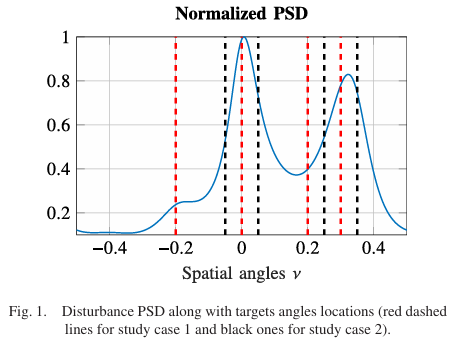
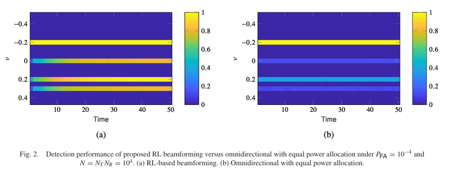
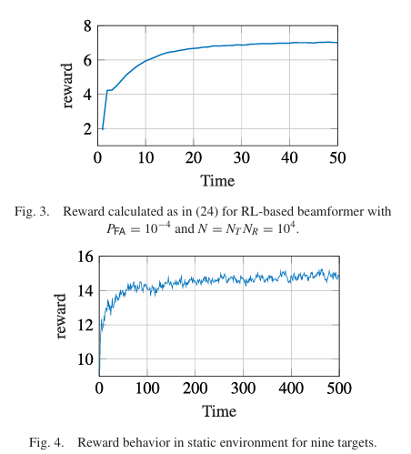
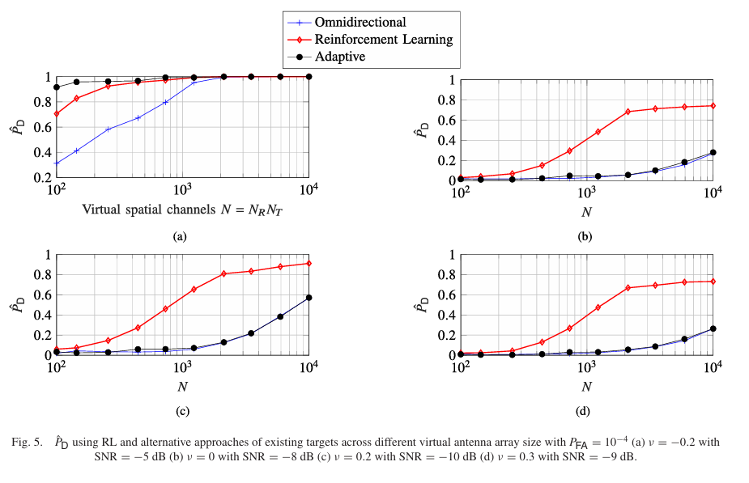
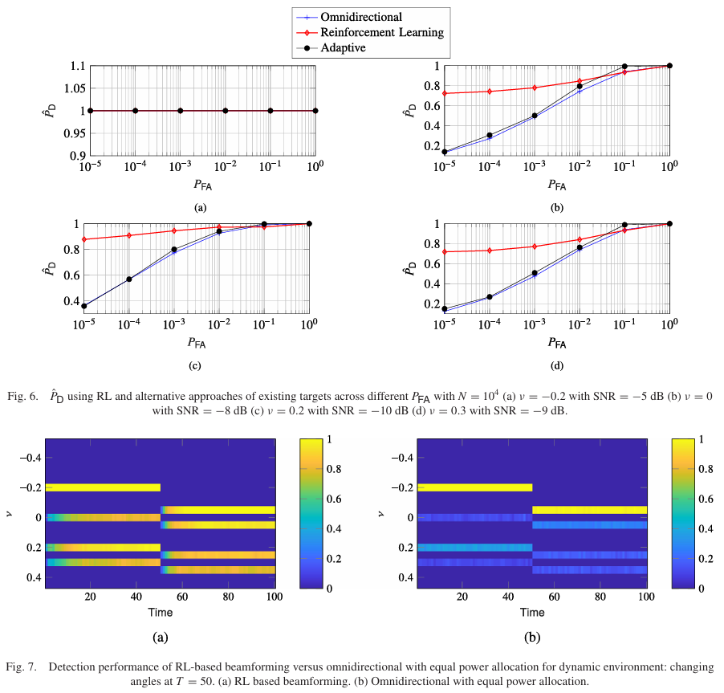
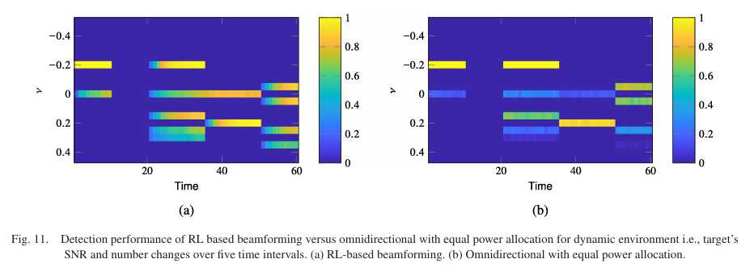

# [RL+MIMO] Large-scale MIMO Radar Multi-Target Detection Method Based on Reinforcement Learning [with MATLAB Code]

Abstract: Cognitive Radar (CR) is a radar system that perceives the environment through a "perception-action" loop, learns from the environment, and makes decisions based on the learned content to complete specific assigned tasks. In non-stationary environments, this loop will continue to repeat, and non-stationarity may be caused by statistical weather / ocean changes, random interference (i.e. Gaussian noise with clutter), or the presence of unknown non-static targets. This paper investigates the problem of multi-target detection in large-scale multi-input multi-output cognitive radar (CR). The concept of cognitive radar is based on the "perception-action" loop, which can perceive dynamic environments and intelligently adapt to the environment to optimally meet specific task requirements. However, this usually requires prior knowledge of the environmental model, which is often unavailable in most cases.
To this end, this paper proposes an algorithm based on reinforcement learning (RL) for achieving cognitive multi-target detection in the presence of unknown statistical characteristics of interference. As an agent, the radar continuously perceives the unknown environment (i.e., targets and interference), and optimizes the emission waveform accordingly, maximizing detection probability by focusing energy at specific distance-angle units (i.e. beam shaping). Additionally, for the optimization problem of beam shaping, this paper also presents a solution with lower complexity than existing methods.
To evaluate the performance of the proposed reinforcement learning-based algorithm in both stationary and dynamic environments, numerical simulations were conducted, and the reinforcement learning beam shaping was compared with traditional equal power allocation wide-beam method and no reinforcement learning adaptive beam shaping. Numerical results show that the reinforcement learning beam shaper outperforms the above two methods in terms of target detection performance. Especially under harsh conditions such as low signal-to-noise ratio, heavy-tailed interference, and rapid change scenarios, the performance improvement is more significant.
Introduction: Haykin clearly distinguishes between traditional feedforward radar, fully adaptive radar, and cognitive radar. When a radar employs a global feedback loop that includes the environment and possibly applies adaptive filtering at the receiver or adaptive beamforming at the transmitter, this type of radar is considered an adaptive radar. Unlike the classical adaptive paradigm, cognitive radar forms its own behavioral rules from acquired experience, stores them in memory, and extends these knowledge to the transmitter, subsequently executing a series of intelligent decisions - actions. Therefore, cognitive radar can significantly benefit from the waveform diversity provided by the transmitter end of a MIMO (Multiple Input Multiple Output) radar system.
Unlike phased arrays, MIMO radar utilizes multiple correlated or uncorrelated detection signals, offering higher degrees of freedom (DoF). There are mainly two types of MIMO radar systems: MIMO radar with larger antenna spacing and co-located MIMO radar. The MIMO radar with larger antenna spacing uses space diversity of target radar cross section (RCS) through the use of spaced apart transmit / receive antennas; whereas co-located MIMO radar has smaller antenna spacing and achieves significant coherent gain through the design of the transmit beamforming, which is attractive for cognitive radar systems because the transmitter can optimize the beamforming based on the received radar echoes.
This paper focuses on the research of co-located large MIMO (MMIMO) radar. In recent years, it has been shown that large MIMO radar can be robust to unknown interference distributions. Moreover, as predicted by related studies, with higher degrees of freedom, large MIMO radar can detect small UAVs (Unmanned Aerial Vehicles), which have a radar cross section three orders of magnitude smaller than manned aircraft. However, while the large MIMO paradigm brings these advantages, it also poses new challenging issues. One of the main open problems for large MIMO radar is how to design robust detection and estimation algorithms with scalable complexity as the number of antennas increases. Moreover, cognitive large MIMO radar requires optimized waveforms, thus, designing scalable and fast accurate optimization algorithms is essential.
Currently, existing research relying on semidefinite programming (SDP) to solve beamforming optimization problems for large MIMO problems introduces higher computational complexity and processing overhead because in these studies, beamforming needs to be completed through two computationally intensive steps: first, optimizing the covariance matrix, and second, using this matrix to synthesize the beamformer.
Complementary to the diversity at the transmitter end and equally important from the receiver's perspective is the recognition of the environment, which guides radar decision-making and controls the selection of waveforms. Haykin et al. and Bell et al. utilized Bayesian filtering to achieve a "perception - action" cycle where the receiver makes a probability prediction of the next environmental state based on its current state. However, this method relies on prior information about the environment dynamics, which could lead to model mismatch. To avoid this reliance on prior information, related research has adopted reinforcement learning (RL) in cognitive radars.
Reinforcement learning is a method for solving unmodeled problems by learning from observations collected by an agent from the environment through software defined intelligent agents and taking actions that maximize the reward function. The interactions between the agent and the environment can be formalized through Markov decision processes (MDP).
This paper proposes a large-scale MIMO cognitive radar multi-target detection algorithm based on reinforcement learning. In this algorithm setup, the radar serves as an agent, and the environment includes both targets and interference. This study assumes no prior information about the environment, especially not making any assumptions about the statistical model of the number of targets and the interference.
Related work In recent years, literature has explored combining machine learning with cognitive radar applications. Related research has used reinforcement learning - cognitive radar for dynamic spectrum allocation. Jiang et al. employed cognitive radar for target detection using an end-to-end learning approach, proposing an alternating process to jointly design the transmission waveform and detector: using neural networks to approximate the generalized likelihood ratio test (GLRT), while fixing the transmission waveform, then training the transmission waveform using deep reinforcement learning against a fixed detector. However, this method does not guarantee detection performance statistically; when the actual interference model does not match the one used in training, detection performance can significantly degrade, and this method does not address the issue of multi-target detection.
Metcalf et al. utilized machine learning methods to estimate the optimal detection threshold based on nonlinear transformations of order statistics, establishing an offline library for the distribution of interference and assuming known covariance matrices to construct it.
In indoor UAV mapping applications, there have been studies that use reinforcement learning for target detection, utilizing drone rotation to achieve mechanical beamforming but only considering Gaussian noise in the detection algorithm.
In the context of large-scale MIMO, there are studies analyzing detection performance using random matrix theory, but these proposed methods require extensive observation data, which is cumbersome.
Unlike the above methods, this paper presents a fully data-driven algorithm that does not require any offline knowledge about possible distributions of interference or their covariance matrices, thus avoiding model mismatch issues.
Main Contributions The contributions of this paper can be summarized as follows:
An original reinforcement learning-based large MIMO cognitive radar detection algorithm is proposed, which does not rely on any prior information about the interference statistical model or the number of targets.
2  
Based on the specific characteristics of large-scale MIMO systems, a reward function based on detection probability is proposed, which is independent of interference distribution.
3  
A beamforming optimization method that can be expanded with the increase of antenna number is proposed, which directly optimizes the beamforming matrix without first optimizing the covariance matrix.
4  
The numerical results show that under the constraint of false alarm probability, this algorithm can detect low signal-to-noise ratio targets and has robustness to environmental changes, such as detecting fading targets and targets with angle position changes.
Conclusion This study investigates the problem of multi-target detection in large-scale MIMO cognitive radar when there are unknown interferences. A novel reinforcement learning beamforming algorithm is proposed, which can detect targets with very low signal-to-noise ratio even in dynamic environments. Specifically, the cognitive radar acts as an intelligent agent by emitting a set of waveforms to illuminate the unknown environment (i.e., targets and interferences), and then calculates the reward function based on the reflected echoes. The reward function is defined as a closed-form asymptotic expression of the detection probability when the number of virtual space antenna channels N tends to infinity (i.e., under the large-scale MIMO regime). The objective of the intelligent agent is to maximize the reward without any prior knowledge about the distribution of interferences or the number of targets through a series of actions. In this paper's algorithm, these actions are adjusted according to the acquired knowledge by optimizing the beamformer to adjust the beam pattern.
Furthermore, this paper proposes a novel beamforming optimization method that is scalable with increasing N and does not increase complexity. Numerical results show that, compared to adaptive and omnidirectional methods, the detection probability performance of the proposed algorithm is outstanding. Additionally, the Receiver Operating Characteristic (ROC) curve confirms that employing an RL-based approach is advantageous in environments with spatially correlated heavy-tailed interference, significantly improving the detection probability for low SNR targets.
To further verify the algorithm's performance, this paper also simulates dynamic environments, including changing target angles, target quantities, and simulating target fading. In all these scenarios, the proposed reinforcement learning beamformer can adapt to rapidly changing environments without any prior knowledge, and provides better performance than traditional (omnidirectional) beamformers.
This paper focuses on the problem of multi-target detection, and future research will explore how to improve the direction of arrival (DoA) estimation for detected targets within the reinforcement learning framework applied in this paper, when the interference distribution is unknown.

## Images

<!-- PAYMENT_BLOCK -->

## Get this dataset

- Payment link (Stripe): [Buy now](https://buy.stripe.com/3cs8yP7sY87d0vu9AB)
- Payment QR code: 

<!-- /PAYMENT_BLOCK -->
